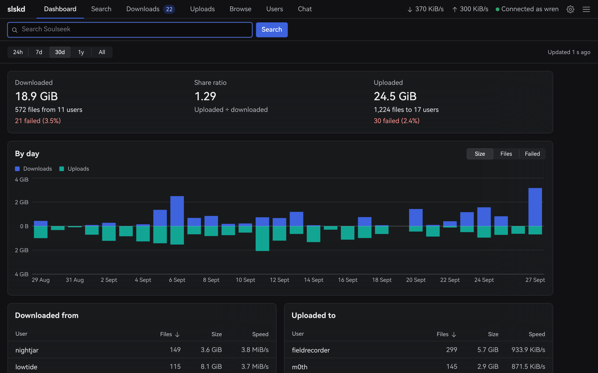
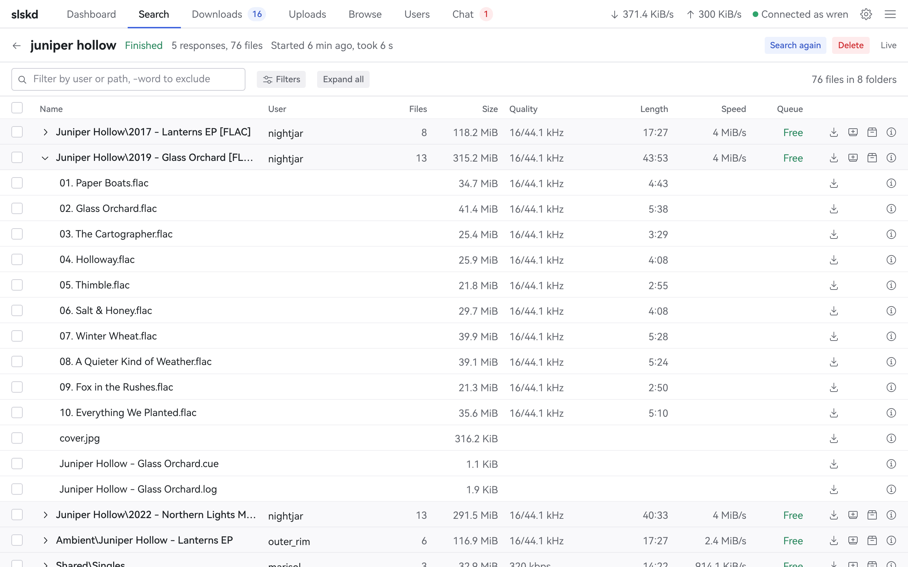
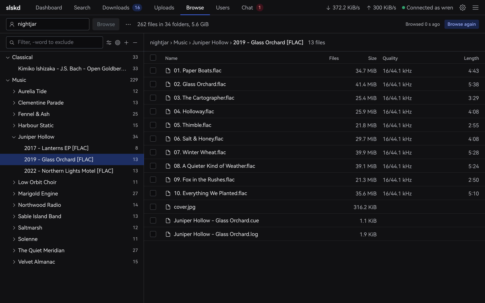

# slskd-alternative-webui

A drop-in replacement web UI for [slskd](https://github.com/slskd/slskd).

|  |  |  |
| ------------------------------------------------------------------------------------------------------ | -------------------------------------------------------------------------------------- | ------------------------------------------------------------------------------------------------- |

## Features

- Long lists are virtualised, and stay responsive while transfers update.
- Transfers, browse and search results are sortable, filterable tables whose columns can be resized and hidden.
- Browsed shares and user profiles persist across reloads and logins.
- Page state, such as the open user, room or conversation and filters and sorts, is stored in the URL.
- Downloading a folder from Browse or a search result keeps its subfolders.
- Files shows each directory's whole tree, with folder sizes and a filter.
- Everything works from the keyboard. Press `?` to show keybinds.

## Install

This application requires slskd 0.26.0 or later.

Download `slskd-alternative-webui.zip` from the
[latest release](https://github.com/wongcallum/slskd-alternative-webui/releases/latest) and unzip it into a directory:

```sh
curl -LO https://github.com/wongcallum/slskd-alternative-webui/releases/latest/download/slskd-alternative-webui.zip
unzip slskd-alternative-webui.zip -d slskd-alternative-webui
```

To build it from source instead, run `pnpm install` and `pnpm build` in a clone of this repository, which writes it to
`dist`. Install the directory in one of these ways:

- Set `web.content_path` in `slskd.yml` (or `SLSKD_CONTENT_PATH`, or `--content-path`) to it, and restart slskd.
  The path must be relative to the directory the slskd binary is in, and slskd refuses to start with an absolute
  path:

  ```yaml
  web:
    content_path: ../slskd-alternative-webui
  ```

- In Docker, mount it over the image's `wwwroot`, for example `-v /path/to/slskd-alternative-webui:/slskd/wwwroot:ro`,
  and recreate the container.
- Replace the contents of the `wwwroot` directory beside the slskd binary with its contents.

To update, replace the directory's contents with the new release's and reload the page. slskd doesn't need a restart.

## Uninstall

- Remove `web.content_path` from `slskd.yml` (or the environment variable or flag), and restart slskd.
- If you replaced the contents of `wwwroot`, restore them from the slskd release you installed.

## Reporting bugs

If you would like to report a bug, please open an [issue](https://github.com/wongcallum/slskd-alternative-webui/issues)
with the steps that cause the bug, and the slskd version, web UI version and OS from System > Info. Please also include
whether your slskd runs in Docker or from a binary, and include any errors from the browser console.

## Development

Install Nix and devenv, then enter the environment with `devenv shell` or `direnv allow`.
It provides Node.js, pnpm, the .NET SDK and Chromium, and links `slskd` to the slskd source pinned in `devenv.lock`.

1. Run `pnpm install`.
2. Run `devenv up -d` to build and start a dev slskd, and `devenv down` to stop it. It runs with `no_connect`, url
   base `/slskd` and login `slskd`/`slskd`, and serves `dist`.
3. Run `pnpm dev` to serve the UI at `http://localhost:5173/slskd/`, proxying the API and hubs to the dev slskd.
   After `pnpm build`, slskd serves the build at `http://localhost:5030/slskd/`.

- To use a real Soulseek account, put `soulseek: { username, password }` in `.devenv/state/slskd/app/slskd.yml` and
  press Connect in the Soulseek popover.
- To run slskd with other settings, run `devenv down` first, then override its environment, for example
  `devenv up -d -O processes.slskd.env.SLSKD_NO_AUTH:string true`.
- To move slskd to its latest commit, run `devenv update slskd`.
- Run `pnpm fmt`, `pnpm lint` and `pnpm test` before committing.

### Tests

Tests that need a Soulseek login run on an instance of [Soulfind](https://github.com/soulfind-dev/soulfind) with two
connected slskd peers sharing test files. Nothing reaches the real Soulseek network.

- To test another slskd, set `SLSKD_BIN` to its `slskd` binary or `slskd.dll`. A release binary needs libicu, or
  `DOTNET_SYSTEM_GLOBALIZATION_INVARIANT=1` where there's none.
- devenv builds Soulfind from the commit pinned in `devenv.yaml` and sets `SOULFIND_BIN`. Soulfind needs an IPv4
  route, though not internet access.
- CI runs the tests against the pinned slskd revision, the minimum version above and the latest release. Weekly, it
  opens a pull request that moves the pin to slskd's master revision.

## License

[AGPL-3.0-or-later](LICENSE)
